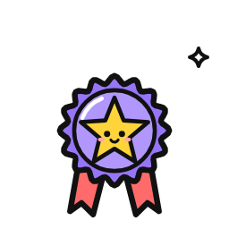

# VibeGif Web Assets & Micro-Interactions

Public domain (CC0) animated WebP and GIF asset library from [vibegif.direct-img.link](https://vibegif.direct-img.link) (repository: `https://github.com/direct-img/vibegif.direct-img.link`).

Every asset is CC0 (Public Domain), requiring no attribution or licensing fees. Perfect for modern web interfaces, playful micro-interactions, live feedback indicators, success modals, and interactive buttons.

---

## 1. Quick Integration Schemes

### Option A: CDN Hotlink (Zero Bandwidth Cost)
All 700+ assets are globally cached on Cloudflare CDN:
```html
<!-- WebP (Modern, lightweight, recommended) -->


<!-- GIF fallback if needed -->

```

### Option B: Local Cached Assets (`assets/images/vibegif/`)
The repository contains 33 curated offline-ready UI assets in `assets/images/vibegif/`:
```html



```

---

## 2. Essential UI & Micro-Interaction Assets

### A. Feedback, Trust & Achievement
| Asset | Category / Action | Local Cached Path | Recommended Size | Use Case |
| :--- | :--- | :--- | :--- | :--- |
| **Verified Badge** | `verified/badge` | `/assets/images/vibegif/verified-badge.webp` | 24x24 or 28x28 | Instructor badges, trust seals, verified certificates |
| **Success Balloons**| `success/balloons` | `/assets/images/vibegif/success-balloons.webp` | 64x64 or 96x96 | Enrollment confirmation, checkout completion modal |
| **Achievement Star**| `achievement/star`| `/assets/images/vibegif/achievement-star.webp` | 32x32 or 48x48 | Milestone reached, course module completion |
| **Trophy Shine** | `trophy/shine` | `/assets/images/vibegif/trophy-shine.webp` | 40x40 or 64x64 | Guarantee seal, top-tier award, leaderboards |
| **Sparkle Shine** | `sparkle/shine` | `/assets/images/vibegif/sparkle-shine.webp` | 20x20 or 24x24 | AI badge accents, "New" features, highlighted buttons |
| **Thumbs Up** | `thumbs/up` | `/assets/images/vibegif/thumbs-up.webp` | 28x28 or 36x36 | Testimonials, reviews, social proof cards |

### B. Action, CTA & Motion
| Asset | Category / Action | Local Cached Path | Recommended Size | Use Case |
| :--- | :--- | :--- | :--- | :--- |
| **Rocket Launch** | `rocket/launch` | `/assets/images/vibegif/rocket-launch.webp` | 32x32 or 48x48 | "Enroll Now", "Apply Today", fast-track careers |
| **Cursor Click** | `cursor/click` | `/assets/images/vibegif/cursor-click.webp` | 24x24 or 32x32 | Interactive guide pointers, click-to-play prompts |
| **Bulb / Idea** | `bulb/idea` | `/assets/images/vibegif/bulb-idea.webp` | 28x28 or 36x36 | Tips, mentorship insights, learning highlights |
| **Gear Turn** | `gear/turn` | `/assets/images/vibegif/gear-turn.webp` | 28x28 or 32x32 | Automation, settings, tools, AI agent workflows |
| **Fireworks Burst**| `fireworks/burst`| `/assets/images/vibegif/fireworks-burst.webp` | 80x80 or 120x120| Graduation celebrations, discount unlocked |

### C. State, Loading & Navigation
| Asset | Category / Action | Local Cached Path | Recommended Size | Use Case |
| :--- | :--- | :--- | :--- | :--- |
| **Loading Bar** | `loading/bar` | `/assets/images/vibegif/loading-bar.webp` | 48x16 or 96x24 | Form submission, card loading state |
| **Spinner Load** | `spinner/load` | `/assets/images/vibegif/spinner-load.webp` | 24x24 or 32x32 | Async button loading, dynamic content fetch |
| **Search Scan** | `search/magnifier`| `/assets/images/vibegif/search-magnifier.webp`| 28x28 or 36x36 | Curriculum search bar, syllabus finder |
| **Calendar Free** | `calendar/free` | `/assets/images/vibegif/calendar-free.webp` | 28x28 or 32x32 | Batch schedules, upcoming dates, slot booking |
| **Clock Tick** | `clock/tick` | `/assets/images/vibegif/clock-tick.webp` | 24x24 or 28x28 | Early bird timer, urgency indicators, duration pill |

### D. E-Commerce & Checkout
| Asset | Category / Action | Local Cached Path | Recommended Size | Use Case |
| :--- | :--- | :--- | :--- | :--- |
| **Payment Card** | `payment/card` | `/assets/images/vibegif/payment-card.webp` | 28x28 or 36x36 | Payment step, installment plans, secure checkout |
| **Wallet Moth** | `wallet/moth` | `/assets/images/vibegif/wallet-moth.webp` | 36x36 or 48x48 | Zero upfront fee callouts, budget-friendly alerts |
| **Coin Spin** | `coin/spin` | `/assets/images/vibegif/coin-spin.webp` | 24x24 or 32x32 | Freelancing earnings, ROI calculators, money-back |
| **Cart Empty** | `cart/empty` | `/assets/images/vibegif/cart-empty.webp` | 48x48 or 64x64 | Empty cart states, book slot reminders |

### E. Error, Warning & Empty States
| Asset | Category / Action | Local Cached Path | Recommended Size | Use Case |
| :--- | :--- | :--- | :--- | :--- |
| **404 Flashlight**| `404/flashlight` | `/assets/images/vibegif/404-flashlight.webp` | 80x80 or 120x120| 404 page, not-found states |
| **Warning Sign** | `warning/sign` | `/assets/images/vibegif/warning-sign.webp` | 28x28 or 36x36 | Limited seats alert, deadline warning |
| **Error Bug** | `error/bug` | `/assets/images/vibegif/error-bug.webp` | 32x32 or 48x48 | Form validation failed, server error banner |

---

## 3. Engineering & Accessibility Guidelines

### A. Respect `prefers-reduced-motion`
To maintain full compliance with accessibility standards (WCAG 2.2.2 & Rule 3):
```css
/* Pause or reduce visual motion when user prefers reduced motion */
@media (prefers-reduced-motion: reduce) {
  .vibe-asset {
    animation: none !important;
    filter: grayscale(20%);
    opacity: 0.85;
  }
}
```

### B. Layout Stability (Prevent CLS)
Always declare exact `width` and `height` attributes on `` tags:
```html

```

### C. Semantic Accessibility (Rule 1)
- If the asset is **purely decorative** (accompanying existing text like "Verified Mentor"):
  `alt="" aria-hidden="true"`
- If the asset conveys **unique information** (like a status icon):
  `alt="Verified Lead Instructor"`

---

## 4. Ready-to-Use UI Patterns

### Pattern 1: High-Conversion CTA Button
```html
<a href="#enroll" class="c-cta-btn c-cta-primary">
  
  <span>Enroll in 2026 Batch</span>
</a>
```

### Pattern 2: Instructor Trust Pill
```html
<div class="c-mentor-trust-pill">
  
  <span>Certified Master Instructor (7+ Years Active)</span>
</div>
```

### Pattern 3: Limited Seats / Early Bird Urgency Pill
```html
<div class="c-urgency-banner">
  
  <span>Only 6 physical classroom lab seats remaining for Morning Batch</span>
</div>
```

### Pattern 4: Milestone Badge in Curriculum
```html
<div class="c-milestone-card">
  
  <h4>1st Paid Client Milestone</h4>
  <p>Hands-on Upwork proposal lab with live contract bidding.</p>
</div>
```

---

## 5. Full Searchable Catalog
The repository includes a complete machine-readable index at:
[`assets/vibegif-catalog.json`](file:///c:/Users/Nisar/Desktop/oneskills%20new123/assets/vibegif-catalog.json)

To query or hotlink any asset among the 700 available items:
```javascript
// URL Formula
const getVibeUrl = (category, action, format = 'webp') => 
  `https://vibegif.direct-img.link/${category}/${action}.${format}`;

// Examples:
// getVibeUrl('cat', 'blink') -> https://vibegif.direct-img.link/cat/blink.webp
// getVibeUrl('robot', 'dance') -> https://vibegif.direct-img.link/robot/dance.webp
// getVibeUrl('sparkle', 'pop') -> https://vibegif.direct-img.link/sparkle/pop.webp
```
