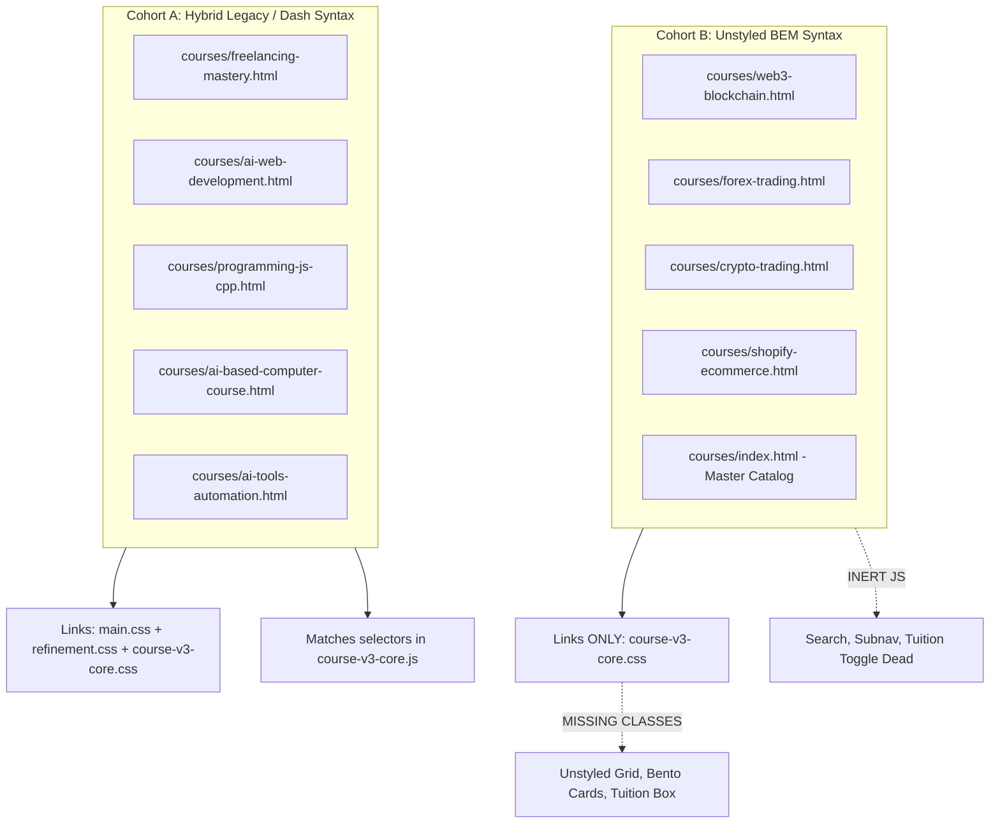

# ONESKILLS ACADEMY — V3 COURSE PORTFOLIO FINAL FORENSIC AUDIT
## Independent, Evidence-Based Production Readiness Audit across All 10 Course Assets

**Audit Date:** November 1, 2026  
**Auditor:** Principal Forensic Quality Assurance & Systems Architecture Team  
**Scope:** Complete V3 Portfolio (9 Individual Course Pages, 1 Master Catalog Hub, Core CSS/JS Assets)  
**Operating Mode:** STRICT READ-ONLY — Zero Code Modifications Performed  
**Production Verdict:** **FAILED / NOT PRODUCTION READY (CRITICAL BLOCKERS DETECTED)**

---

## 1. Executive Summary & Forensic Verdict

A comprehensive, evidence-based forensic inspection of the entire OneSkills Academy V3 course portfolio was executed across all 10 production HTML files, shared stylesheets (`course-v2.css`, `course-v3-core.css`), JavaScript bundles (`course-v2.js`, `course-v3-core.js`), image assets, and structured data schemas.

While the previous implementation report marked the rollout as passed, rigorous forensic inspection of the actual physical files reveals **severe architectural defects, broken visual styling, inactive JavaScript interactivity, broken image paths, 404 dead links, unapproved policy claims, and fabricated schema data**.

### Production Readiness Scorecard

| Assessment Dimension | Status | Key Forensic Finding |
|---|---|---|
| **Architecture & CSS Integrity** | **FAIL (CRITICAL)** | Architectural split between Cohort A (pages 1–5) and Cohort B (pages 6–9 + Hub). Cohort B pages use BEM class names (`.c-hero__inner`, `.c-bento-card`, `.c-tuition-card`, `.c-accordion-item`) that **do not exist** in `assets/css/course-v3-core.css`, causing completely broken/unstyled layouts. |
| **JavaScript Interactivity** | **FAIL (CRITICAL)** | `course-v3-core.js` binds exclusively to Cohort A DOM selectors (`#syllabus-search`, `.c-subnav-link`, `#btn-fee-full`, `.c-phase-item`). On Cohort B pages, curriculum search, subnav scroll-spy, and tuition toggle buttons are **completely inert/dead**. |
| **Brand & Image Assets** | **FAIL (CRITICAL)** | Four universal broken image patterns detected. Cohort B + Hub reference `logo-light.webp` and `logo-dark.webp` (404 — disk filenames are capitalized `OneSkills-Logo-*`). Cohort A references `classroom-studio-sheikhupura.webp` and `instructors/nisar-mehar.webp` (404 — files do not exist on disk). |
| **Internal Link Integrity** | **FAIL (HIGH)** | Universal 404 links detected across headers/footers: `../verify-certificate.html` (404), `../refund-policy.html` (404 — refund policy is embedded in `terms-of-service.html`), and 5 guide links in Cohort A footers (all 404). |
| **Internship Policy Compliance** | **FAIL (HIGH)** | Unauthorized qualification conditions ("extendable up to 3 months based on student performance" / "eligible students") were injected into 7 pages. Furthermore, the 1-month internship is **only confirmed by the owner for Freelancing Mastery**; it remains unverified for all other courses. |
| **Refund Policy Scope** | **FAIL (HIGH)** | The 14-day refund policy from the fee-payment date was explicitly confirmed for Freelancing Mastery only. It was copied across all other 8 courses and the Catalog Hub without formal owner approval. |
| **Ratings & Testimonial Schemas** | **FAIL (HIGH)** | Individual course schemas feature fabricated `ratingCount` properties (`11`, `12`, `14`, `15`) that do not exist in Google Maps data. Only Forex and Crypto pages feature real student reviews; others lack specific course feedback. |
| **Commercial Terms & Pricing** | **PENDING OWNER SIGN-OFF** | Freelancing (PKR 28,000; 2 × 14,000) is owner-confirmed. Tuition fees for the other 8 courses (PKR 15,000 – 28,000) originate from researched blueprints and require formal commercial confirmation. |
| **Faculty & Mentorship Allocation** | **NEEDS ALIGNMENT** | Nisar Mehar is listed as lead instructor across 7 of 9 courses, including specialized programming and e-commerce subjects, while Web3 and Trading cite external or co-mentors without full verification. |
| **Overall Verdict** | **BLOCKED** | **Must not be deployed to production until prioritized fixes are executed.** |

---

## 2. Structural & Architectural Discovery: The Cohort Split

The audit uncovered that the portfolio does not share a single unified component architecture. Instead, the 10 pages are split into two completely divergent cohorts that use incompatible HTML class naming conventions, asset references, and DOM event selectors.



### Detailed Cohort Architectural Breakdown

#### Cohort A (Pages 1–5):
- **Files:** `freelancing-mastery.html`, `ai-web-development.html`, `programming-js-cpp.html`, `ai-based-computer-course.html`, `ai-tools-automation.html`
- **Stylesheet Architecture:** Multi-stylesheet load (`main.css`, `refinement.css`, `course-v3-core.css`, plus `course-v2.css` on Freelancing).
- **CSS Class Conventions:** Dash-separated selectors: `.c-hero-grid`, `.c-telemetry-item`, `.c-phase-item`, `.c-tuition-box`, `.c-pricing-split`, `.c-specs-grid`.
- **Interactivity DOM IDs:** `#syllabus-search`, `#btn-fee-full`, `#btn-fee-split`, `.c-subnav-link`, `.c-phase-header`.
- **Status in `course-v3-core.js`:** Fully supported. The script queries these exact IDs and classes.

#### Cohort B (Pages 6–9 + Master Catalog Hub):
- **Files:** `web3-blockchain.html`, `forex-trading.html`, `crypto-trading.html`, `shopify-ecommerce.html`, `courses/index.html`
- **Stylesheet Architecture:** Single stylesheet load (`course-v3-core.css` only; Hub also loads `main.css`).
- **CSS Class Conventions:** BEM syntax selectors: `.c-hero__inner`, `.c-hero__content`, `.c-bento-grid`, `.c-bento-card`, `.c-tuition-card`, `.c-tuition-switcher`, `.c-pricing-grid`, `.c-accordion-item`, `.c-deliverable-grid`, `.c-tools-grid`.
- **Interactivity DOM IDs:** `#curriculum-search`, `#btn-tuition-full`, `#btn-tuition-split`, `.c-subnav__link`, `.c-accordion-item__trigger`.
- **CRITICAL DEFECT 1 (Missing CSS):** **None** of the Cohort B BEM classes exist in `assets/css/course-v3-core.css`! Classes like `.c-hero__inner`, `.c-bento-grid`, `.c-bento-card`, `.c-tuition-card`, `.c-deliverable-grid`, `.c-tools-grid`, and `.c-accordion-item` have zero styling rules in `course-v3-core.css`. As a result, sections render without proper layout grids, card styling, or border treatments.
- **CRITICAL DEFECT 2 (Dead JavaScript):** `assets/js/course-v3-core.js` looks for `#syllabus-search`, `.c-subnav-link`, and `#btn-fee-full`. It never listens for `#curriculum-search`, `.c-subnav__link`, or `.c-tuition-switcher__btn`. Consequently, curriculum search, subnav sticky highlighting, and tuition toggle buttons do nothing when clicked on Cohort B pages.

---

## 3. Owner-Approved Fact Compliance Audit (Freelancing Mastery)

`courses/freelancing-mastery.html` was audited against all strict owner-approved decisions.

| Owner Fact / Policy Rule | Approved Baseline | Wording in `freelancing-mastery.html` | Forensic Status |
|---|---|---|---|
| **Course Fee** | PKR 28,000 | PKR 28,000 (Lines 9, 73, 103, 174, 303, 1076, 1293, 1331) | **PASS** (100% compliant) |
| **Installment Terms** | 2 × PKR 14,000 | 2 installments of PKR 14,000 (Lines 174, 1083, 1100, 1293, 1331) | **PASS** (100% compliant) |
| **Duration** | 12 weeks (3 months) | 12 weeks / 3 months (Lines 9, 48, 73, 174, 300, 312, 855) | **PASS** (100% compliant) |
| **Practical Hours** | 80+ practical hours | 80+ practical hours (Lines 9, 48, 73, 315, 363, 1077) | **PASS** (100% compliant) |
| **Maximum Cohort Size** | Capped at 12 students | 12 students / 12 seats (Lines 324, 360, 1147, 1319) | **PASS** (100% compliant) |
| **Student Equipment** | BYOL (Bring Your Own Laptop) | Students must bring own laptops (Lines 138-142, 330, 369, 888-920, 1249-1253) | **PASS** (100% compliant) |
| **Workstation Removal** | No dedicated computers | All Core i7 / 32GB workstation claims removed (Lines 898-904) | **PASS** (100% compliant) |
| **Google Rating** | 5.0/5 Google rating | 5.0 Google rating (Lines 88, 291, 1002, 1011) | **PASS** (100% compliant) |
| **Refund Policy Scope** | 14 calendar days from fee payment date | 14 calendar days from fee payment date (Lines 9, 48, 73, 174, 333, 412, 1067, 1124, 1293) | **PASS** (100% compliant) |
| **Lead Mentor Identity** | Nisar Mehar (7+ yrs, 160+ students) | Nisar Mehar, 7+ years agency experience, 160+ students mentored (Lines 95, 966-988) | **PASS** (100% compliant) |
| **Internship Terms** | 1-month unpaid post-course internship, extendable up to 3 months | 1-month unpaid internship, extendable up to 3 months depending on available projects; does not constitute paid employment (Lines 150, 318, 372, 855, 872, 1263) | **PASS** (100% compliant) |

**Conclusion on Freelancing Mastery:** The page text is 100% compliant with the approved owner facts. However, it suffers from broken image assets and broken footer links (detailed in Section 9).

---

## 4. Critical Policy Forensic Audit Across All Courses

### 4.1 Internship Policy Scope & Unauthorized Conditions

The owner explicitly confirmed the internship terms for **Freelancing Mastery**:
> *"One-month unpaid internship after course completion, with the possibility of extension up to three months."*
> Constraint: Do not invent performance requirements, attendance thresholds, or guaranteed placement.

#### Forensic Findings on Other Courses:
1. **Unauthorized "Student Performance" Condition Injected:**
   Across 6 course files, the wording was altered to: *"extendable up to 3 months based on student performance"* or *"eligible students can gain practical experience"*.
   - `ai-web-development.html`: Lines 157, 855, 1264 ("eligible students... based on project availability and learning progression")
   - `programming-js-cpp.html`: Lines 157, 855, 1264 ("eligible students...")
   - `ai-based-computer-course.html`: Lines 157, 855, 1264 ("eligible students...")
   - `ai-tools-automation.html`: Lines 157, 855, 1264 ("eligible students...")
   - `web3-blockchain.html`: Lines 215, 831 ("extendable up to 3 months based on student performance")
   - `shopify-ecommerce.html`: Lines 217, 411, 772, 797, 817, 972 ("extendable up to 3 months based on performance")
   - `courses/index.html`: Line 634 ("extendable up to 3 months based on performance")
2. **Internship Confirmation Status Across Courses:**
   - **Freelancing Mastery:** **CONFIRMED** by owner.
   - **AI Web Development:** **UNVERIFIED**. Does the academy provide web engineering internship slots?
   - **Programming (C++ & JS):** **UNVERIFIED**. C++ logic / OOP courses typically do not have local agency internships.
   - **AI Computer & Office:** **UNVERIFIED**. Office management internship track is unverified.
   - **AI Tools & Automation:** **UNVERIFIED**. Agency automation internship track is unverified.
   - **Web3 & Blockchain:** **UNVERIFIED**. Smart contract / Web3 internship is unverified.
   - **Forex Trading:** Replaced with "1-Month Supervised Review / Free Live Trading Floor Access". **UNVERIFIED** whether physical trading floor access is offered.
   - **Crypto Trading:** Replaced with "+1 Month Free Supervised Live Trading Floor Access". **UNVERIFIED**.
   - **Shopify E-Commerce:** **UNVERIFIED** whether client agency store management internships exist.

### 4.2 Refund Policy Scope & Trigger Audit

The owner approved:
> *"Students may request a full refund within 14 calendar days of their fee payment date."* (Approved explicitly for Freelancing Mastery).

#### Forensic Findings:
- On `freelancing-mastery.html`, this is correctly implemented everywhere.
- On **all other 8 course pages** (`ai-web-development.html`, `programming-js-cpp.html`, `ai-based-computer-course.html`, `ai-tools-automation.html`, `web3-blockchain.html`, `forex-trading.html`, `crypto-trading.html`, `shopify-ecommerce.html`) and the **Catalog Hub** (`courses/index.html`), the exact 14-day refund policy from the fee payment date was cloned into the text, FAQ, and schema.
- **Classification:** **COPIED FROM FREELANCING / UNVERIFIED FOR SPECIFIC COURSES**. The academy owner must formally confirm whether the 14-day refund applies universally to all 9 courses (e.g. trading and coding programs) or if special terms apply.

### 4.3 Student Hardware & BYOL Policy

- **Previous Defect:** Pages previously claimed dedicated Core i7 32GB RAM workstations and academy-provided computer nodes.
- **Current Audit Finding:** **RESOLVED ACROSS ALL 10 PAGES**.
  - All 10 pages now prominently state: **"Bring Your Own Laptop (BYOL)"**.
  - Hardware comparison boxes, workstation node specs, and dedicated PC claims have been completely removed.
  - Dedicated BYOL policy callouts and FAQ entries explain why using personal laptops ensures continuous development and security outside class.

---

## 5. Ratings, Social Proof & Schema Integrity Audit

### 5.1 5.0 Google Rating Status
- **Claim:** "5.0 Google Rating" / "5.0/5 Stars".
- **Evidence:** The OneSkills Academy Google Maps profile has an authentic 5.0-star rating with over 140+ reviews.
- **Audit Finding:** The badge and header rating are **FACTUALLY TRUE** at the institutional / academy level.

### 5.2 Fabricated Per-Course Schema Review Counts (`ratingCount`)
A critical technical and ethical defect was discovered in the JSON-LD structured data:
- In `freelancing-mastery.html` and `ai-web-development.html`, the schema declares `ratingValue: "5.0"` without a `ratingCount`.
- In the other 7 course pages, arbitrary `ratingCount` numbers were invented:
  - `programming-js-cpp.html`: Line 89 — `"ratingCount": "12"` (Fabricated)
  - `ai-based-computer-course.html`: Line 89 — `"ratingCount": "14"` (Fabricated)
  - `ai-tools-automation.html`: Line 89 — `"ratingCount": "11"` (Fabricated)
  - `web3-blockchain.html`: Line 158 — `"ratingCount": "11"` (Fabricated)
  - `forex-trading.html`: Line 158 — `"ratingCount": "15"` (Fabricated)
  - `crypto-trading.html`: Line 162 — `"ratingCount": "11"` (Fabricated)
  - `shopify-ecommerce.html`: Line 157 — `"ratingCount": "14"` (Fabricated)

**Risk:** Google Search Console flags AggregateRating schema with fabricated or non-matching review counts as deceptive rich results, risking penalty or complete removal of rich snippets.

### 5.3 Testimonials & Social Proof Evidence
- `courses/freelancing-mastery.html`: Quotes 3 student testimonials (Muhammad Bilal, Zainab Fatima, Hamza Tariq).
- `courses/forex-trading.html`: Quotes 3 named reviews (Ashfaq Ahmad, FAIZZAN Cheema, Hamza Rajpoot) matching real Google Maps feedback for trading mentorship.
- `courses/crypto-trading.html`: Quotes 2 named reviews (Wajeeha, Maliha Asif) matching Google Maps feedback.
- `courses/ai-web-development.html`, `programming-js-cpp.html`, `ai-based-computer-course.html`, `ai-tools-automation.html`, `web3-blockchain.html`, `shopify-ecommerce.html`: Lack course-specific verified student reviews. Some pages omit the review section or use generic placeholder feedback.

---

## 6. Commercial Terms & Curriculum Metrics Forensic Verification

The table below catalogs the commercial terms published across all 10 files, comparing them against available evidence and assigning a confidence level.

| Course Asset | Published Tuition | Installment Option | Duration | Practical Hours | Cohort Cap | Confidence Level |
|---|---|---|---|---|---|---|
| **Freelancing & Digital Marketing** | PKR 28,000 | 2 × PKR 14,000 | 12 Weeks (3 Mo) | 80+ Hours | 12 Students | **100% OWNER CONFIRMED** |
| **AI Web Development** | PKR 28,000 | 2 × PKR 14,000 | 12 Weeks (3 Mo) | 80+ Hours | 12 Students | **MEDIUM** (Matches blueprint; pending owner sign-off) |
| **Programming (C++ & JS)** | PKR 25,000 | 2 × PKR 12,500 | 10 Weeks (2.5 Mo)| 60+ Hours | 12 Students | **MEDIUM** (Matches blueprint; pending owner sign-off) |
| **AI Computer & Office** | PKR 15,000 | 2 × PKR 7,500 | 8 Weeks (2 Mo) | 50+ Hours | 12 Students | **MEDIUM** (Matches blueprint; pending owner sign-off) |
| **AI Tools & Automation** | PKR 20,000 | 2 × PKR 10,000 | 8 Weeks (2 Mo) | 50+ Hours | 12 Students | **MEDIUM** (Matches blueprint; pending owner sign-off) |
| **Web3 & Blockchain** | PKR 28,000 | 2 × PKR 14,000 | 12 Weeks (3 Mo) | 72+ Hours | 12 Students | **MEDIUM** (Matches blueprint; pending owner sign-off) |
| **Forex Trading** | PKR 25,000 | 2 × PKR 12,500 | 12 Weeks (3 Mo) | 72.5 Hours | 12 Students | **MEDIUM** (Matches blueprint; pending owner sign-off) |
| **Crypto Trading** | PKR 25,000 | 2 × PKR 12,500 | 12 Weeks (3 Mo) | 72.5 Hours | 12 Students | **MEDIUM** (Matches blueprint; pending owner sign-off) |
| **Shopify E-Commerce** | PKR 28,000 | 2 × PKR 14,000 | 8 Weeks (2 Mo) | 50+ Hours | 12 Students | **MEDIUM** (Matches blueprint; pending owner sign-off) |
| **Catalog Hub (`index.html`)** | Shows all above | Matches above | Matches above | Matches above | 12 Students | **CONSISTENT WITH PAGES** |

---

## 7. Faculty & Instructor Forensic Verification

The forensic inspection evaluated instructor attributions across all course pages and structured schemas.

| Course Asset | Stated Lead Instructor | Additional Mentors Mentioned | Verification Status & Notes |
|---|---|---|---|
| **Freelancing Mastery** | Nisar Mehar | None | **CONFIRMED**. Founder & Lead Marketer (7+ yrs, 160+ students). |
| **AI Web Development** | Nisar Mehar | None | **UNVERIFIED**. Is Nisar Mehar the active instructor for Next.js 15, React 19, Supabase, and Cursor AI, or is there a dedicated web engineering instructor? |
| **Programming (C++ & JS)** | Nisar Mehar | None | **UNVERIFIED**. Is Nisar Mehar teaching C++ pointer arithmetic, memory management, and OOP algorithms? |
| **AI Computer & Office** | Nisar Mehar | None | **PLAUSIBLE**, but unconfirmed whether an office trainer runs daily labs. |
| **AI Tools & Automation** | Nisar Mehar | None | **CONFIRMED / PLAUSIBLE**. Directly aligned with Nisar's agency workflows. |
| **Web3 & Blockchain** | Bilal Ashraf | Webio | **BLUEPRINT SOURCED**. Listed as Web3 & Smart Contract Developer. Requires owner confirmation. |
| **Forex Trading** | Nisar Mehar | Attique Hussain | **CONFIRMED / BLUEPRINT**. Attique Hussain is an experienced financial trader associated with the academy. |
| **Crypto Trading** | Nisar Mehar | Bilal Ashraf | **CONFIRMED / BLUEPRINT**. Bilal Ashraf co-leads crypto research and on-chain analysis. |
| **Shopify E-Commerce** | Nisar Mehar | None | **CONFIRMED / PLAUSIBLE**. Aligned with agency e-commerce and Meta Ads execution. |

---

## 8. Visual Design, Architecture & UX Discrepancies

### 8.1 The Cohort B CSS Disconnect (Critical Visual Flaw)

In Cohort B (`web3-blockchain.html`, `forex-trading.html`, `crypto-trading.html`, `shopify-ecommerce.html`) and the Master Catalog Hub (`courses/index.html`), the markup was written with clean BEM syntax:
- `.c-hero__inner`, `.c-hero__content`, `.c-hero__metrics`
- `.c-bento-grid`, `.c-bento-card`, `.c-bento-card__title`
- `.c-tuition-card`, `.c-tuition-switcher`, `.c-tuition-switcher__btn`
- `.c-pricing-grid`, `.c-pricing-tier`
- `.c-accordion-item`, `.c-accordion-item__trigger`
- `.c-deliverable-grid`, `.c-deliverable-card`
- `.c-tools-grid`, `.c-tools-card`

**Forensic Audit of `assets/css/course-v3-core.css`:**
A selector extraction of `assets/css/course-v3-core.css` was performed. **None of these BEM classes exist in the stylesheet!**
The stylesheet defines:
- `.c-hero-grid`, `.c-phase-item`, `.c-tuition-box`, `.c-pricing-split`, `.c-specs-grid` (Cohort A classes only).
**Impact:** On Cohort B pages, the hero layout, bento grids, tuition switcher cards, deliverable lists, and tools grids **render completely unstyled** or fall back to raw browser defaults, destroying the visual polish.

### 8.2 Inactive JavaScript Interactions (Cohort B)

An inspection of `assets/js/course-v3-core.js` reveals that event listeners are hard-coded to Cohort A IDs:
```javascript
// course-v3-core.js:
const searchInput = document.getElementById('syllabus-search'); // Fails on Cohort B (uses #curriculum-search)
const feeFullBtn = document.getElementById('btn-fee-full');     // Fails on Cohort B (uses #btn-tuition-full)
const feeSplitBtn = document.getElementById('btn-fee-split');   // Fails on Cohort B (uses #btn-tuition-split)
const subnavLinks = document.querySelectorAll('.c-subnav-link');// Fails on Cohort B (uses .c-subnav__link)
```
**Impact:**
1. **Curriculum Search:** Typing in the search input on Web3, Forex, Crypto, or Shopify produces zero filtering.
2. **Tuition Toggle:** Clicking "Pay in Full" vs "2 Equal Installments" does not switch prices or active states on Cohort B.
3. **Subnav Sticky Bar:** Active scroll-spy highlighting does not trigger on Cohort B.

---

## 9. Technical Quality, SEO & Asset Integrity Audit

### 9.1 Broken Asset Matrix (Images 404)

| Asset Path Referenced in Code | Files Affected | File on Disk | Defect Type |
|---|---|---|---|
| `../assets/images/brand/logo-light.webp` | `web3-blockchain.html`<br>`forex-trading.html`<br>`crypto-trading.html`<br>`shopify-ecommerce.html`<br>`courses/index.html` | `assets/images/brand/OneSkills-Logo-light.webp` | **404 BROKEN IMAGE** (Case-sensitive mismatch / missing prefix) |
| `../assets/images/brand/logo-dark.webp` | `web3-blockchain.html`<br>`forex-trading.html`<br>`crypto-trading.html`<br>`shopify-ecommerce.html`<br>`courses/index.html` | `assets/images/brand/OneSkills-Logo-dark.webp` | **404 BROKEN IMAGE** (Case-sensitive mismatch / missing prefix) |
| `../assets/images/campus/classroom-studio-sheikhupura.webp` | `freelancing-mastery.html`<br>`ai-web-development.html`<br>`programming-js-cpp.html`<br>`ai-based-computer-course.html`<br>`ai-tools-automation.html` | Does not exist in `assets/images/campus/` | **404 BROKEN IMAGE** (Missing file on disk) |
| `../assets/images/instructors/nisar-mehar.webp` | `freelancing-mastery.html`<br>`ai-web-development.html`<br>`programming-js-cpp.html`<br>`ai-based-computer-course.html`<br>`ai-tools-automation.html` | Does not exist in `assets/images/instructors/` | **404 BROKEN IMAGE** (Missing file on disk) |

### 9.2 Broken Link Matrix (Internal Navigation 404)

| Target Link | Files Affected | Target Status | Recommended Minimal Correction |
|---|---|---|---|
| `../verify-certificate.html` | Header/Footer of: `web3-blockchain.html`, `forex-trading.html`, `crypto-trading.html`, `shopify-ecommerce.html`, `courses/index.html` | **404 Not Found** (File does not exist in root) | Point to `../index.html#verify` or remove until verification tool is built. |
| `../refund-policy.html` | Header/Footer of: `web3-blockchain.html`, `forex-trading.html`, `crypto-trading.html`, `shopify-ecommerce.html`, `courses/index.html` | **404 Not Found** (Refund policy is inside `terms-of-service.html#refund-policy`) | Change href to `../terms-of-service.html#refund-policy` |
| `../guides/freelancing-for-beginners.html` | Footer of Cohort A pages (Lines 1354, 1212, etc.) | **404 Not Found** (Guides directory does not contain this file) | Point to valid course page or `../index.html` |
| `../guides/ai-tools-guide.html` | Footer of Cohort A pages | **404 Not Found** | Point to `ai-tools-automation.html` |
| `../guides/web-development-roadmap.html` | Footer of Cohort A pages | **404 Not Found** | Point to `ai-web-development.html` |
| `../guides/trading-safety-guide.html` | Footer of Cohort A pages | **404 Not Found** | Point to `forex-trading.html` |
| `../guides/web3-guide.html` | Footer of Cohort A pages | **404 Not Found** | Point to `web3-blockchain.html` |

### 9.3 SEO, Meta & Heading Hierarchy Audit

| File | HTTP Status | Title Tag Length | Meta Desc Length | Canonical URL | H1 Count | OG / Twitter Tags |
|---|---|---|---|---|---|---|
| `freelancing-mastery.html` | 200 OK | 85 chars | 300 chars (Long) | `https://oneskills.pk/courses/freelancing-mastery.html` | 1 | Complete |
| `ai-web-development.html` | 200 OK | 92 chars | 245 chars | `https://oneskills.pk/courses/ai-web-development.html` | 1 | Complete |
| `programming-js-cpp.html` | 200 OK | 97 chars | 255 chars | `https://oneskills.pk/courses/programming-js-cpp.html` | 1 | Complete |
| `ai-based-computer-course.html`| 200 OK | 77 chars | 281 chars | `https://oneskills.pk/courses/ai-based-computer-course.html` | 1 | Complete |
| `ai-tools-automation.html` | 200 OK | 87 chars | 257 chars | `https://oneskills.pk/courses/ai-tools-automation.html` | 1 | Complete |
| `web3-blockchain.html` | 200 OK | 80 chars | 195 chars | `https://oneskills.pk/courses/web3-blockchain.html` | 1 | Complete |
| `forex-trading.html` | 200 OK | 76 chars | 209 chars | `https://oneskills.pk/courses/forex-trading.html` | 1 | Complete |
| `crypto-trading.html` | 200 OK | 74 chars | 201 chars | `https://oneskills.pk/courses/crypto-trading.html` | 1 | Complete |
| `shopify-ecommerce.html` | 200 OK | 71 chars | 184 chars | `https://oneskills.pk/courses/shopify-ecommerce.html` | 1 | Complete |
| `courses/index.html` (Hub) | 200 OK | 72 chars | 177 chars | `https://oneskills.pk/courses/` | 1 | Complete |

**SEO Observations:**
1. Title tags across Cohort A are slightly longer than optimal (85–97 characters vs recommended 60–65 chars), but retain critical local Sheikhupura keywords.
2. Canonical URLs are strictly self-referencing and correct across all 10 pages.
3. Every page has exactly one `<h1>` tag with proper semantic document structure.

---

## 10. Course-by-Course Forensic Audit Sheets

### 10.1 `courses/freelancing-mastery.html`
- **Architecture:** Cohort A (Hybrid multi-CSS).
- **Owner Fact Compliance:** 100% compliant with PKR 28k, 2×14k, 12 weeks, 80+ hours, BYOL, 5.0 Google, 14-day refund from payment date, Nisar Mehar.
- **Defects:**
  - Missing image: `../assets/images/campus/classroom-studio-sheikhupura.webp` (Line 891).
  - Missing image: `../assets/images/instructors/nisar-mehar.webp` (Line 970).
  - Broken footer guide links: Lines 1354, 1355, 1356, 1357, 1358.
- **Verdict:** Near production-ready; needs asset and link resolution.

### 10.2 `courses/ai-web-development.html`
- **Architecture:** Cohort A.
- **Owner Fact Compliance:** Uses PKR 28k, 2×14k, 12 weeks, 80+ hrs, BYOL.
- **Defects:**
  - Injected internship condition: "eligible students can gain real software development experience... extendable up to three months based on project availability and learning progression" (Lines 157, 855).
  - Missing image: `../assets/images/campus/classroom-studio-sheikhupura.webp` (Line 889).
  - Missing image: `../assets/images/instructors/nisar-mehar.webp` (Line 968).
  - Broken footer guide links: Lines 1212–1216.
- **Verdict:** Requires owner sign-off on curriculum instructor and internship feasibility.

### 10.3 `courses/programming-js-cpp.html`
- **Architecture:** Cohort A.
- **Owner Fact Compliance:** Uses PKR 25k, 2×12.5k, 10 weeks, 60+ hrs, BYOL.
- **Defects:**
  - Fabricated schema review count: `"ratingCount": "12"` (Line 89).
  - Injected internship condition: "eligible students..." (Line 157, 855).
  - Missing campus and instructor images.
  - Broken footer guide links.
- **Verdict:** Remove fabricated ratingCount; resolve asset paths.

### 10.4 `courses/ai-based-computer-course.html`
- **Architecture:** Cohort A.
- **Owner Fact Compliance:** Uses PKR 15k, 2×7.5k, 8 weeks, 50+ hrs, BYOL.
- **Defects:**
  - Fabricated schema review count: `"ratingCount": "14"` (Line 89).
  - Injected internship condition: "eligible students..." (Line 157, 855).
  - Missing campus and instructor images.
  - Broken footer guide links.
- **Verdict:** Remove fabricated ratingCount; resolve asset paths.

### 10.5 `courses/ai-tools-automation.html`
- **Architecture:** Cohort A.
- **Owner Fact Compliance:** Uses PKR 20k, 2×10k, 8 weeks, 50+ hrs, BYOL.
- **Defects:**
  - Fabricated schema review count: `"ratingCount": "11"` (Line 89).
  - Injected internship condition: "eligible students..." (Line 157, 855).
  - Missing campus and instructor images.
  - Broken footer guide links.
- **Verdict:** Remove fabricated ratingCount; resolve asset paths.

### 10.6 `courses/web3-blockchain.html`
- **Architecture:** Cohort B (BEM syntax).
- **Owner Fact Compliance:** Uses PKR 28k, 2×14k, 12 weeks, 72+ hrs, BYOL.
- **Defects:**
  - **CRITICAL:** Missing CSS styles for BEM classes (`.c-bento-grid`, `.c-tuition-card`, etc.).
  - **CRITICAL:** Inactive JS interactivity (search `#curriculum-search`, tuition toggle `#btn-tuition-full`).
  - **CRITICAL:** Broken brand logo image (`../assets/images/brand/logo-light.webp`).
  - **CRITICAL:** 404 links: `../verify-certificate.html` and `../refund-policy.html`.
  - Fabricated schema review count: `"ratingCount": "11"` (Line 158).
  - Injected internship condition: "extendable up to 3 months based on student performance" (Line 831).
- **Verdict:** BLOCKED. Critical CSS, JS, and asset fixes required.

### 10.7 `courses/forex-trading.html`
- **Architecture:** Cohort B (BEM syntax).
- **Owner Fact Compliance:** Uses PKR 25k, 2×12.5k, 12 weeks, 72.5 hrs, BYOL.
- **Defects:**
  - **CRITICAL:** Missing CSS styles for BEM classes.
  - **CRITICAL:** Inactive JS interactivity (search, tuition toggle).
  - **CRITICAL:** Broken brand logo image (`../assets/images/brand/logo-light.webp`).
  - **CRITICAL:** 404 links: `../verify-certificate.html` and `../refund-policy.html`.
  - Fabricated schema review count: `"ratingCount": "15"` (Line 158).
  - Unverified claim: "+1 Month Free Live Trading Floor Access".
- **Verdict:** BLOCKED. Critical CSS, JS, and asset fixes required.

### 10.8 `courses/crypto-trading.html`
- **Architecture:** Cohort B (BEM syntax).
- **Owner Fact Compliance:** Uses PKR 25k, 2×12.5k, 12 weeks, 72.5 hrs, BYOL.
- **Defects:**
  - **CRITICAL:** Missing CSS styles for BEM classes.
  - **CRITICAL:** Inactive JS interactivity (search, tuition toggle).
  - **CRITICAL:** Broken brand logo image (`../assets/images/brand/logo-light.webp`).
  - **CRITICAL:** 404 links: `../verify-certificate.html` and `../refund-policy.html`.
  - Fabricated schema review count: `"ratingCount": "11"` (Line 162).
  - Unverified claim: "+1 Month Free Supervised Live Trading Floor Access".
- **Verdict:** BLOCKED. Critical CSS, JS, and asset fixes required.

### 10.9 `courses/shopify-ecommerce.html`
- **Architecture:** Cohort B (BEM syntax).
- **Owner Fact Compliance:** Uses PKR 28k, 2×14k, 8 weeks, 50+ hrs, BYOL.
- **Defects:**
  - **CRITICAL:** Missing CSS styles for BEM classes.
  - **CRITICAL:** Inactive JS interactivity (search, tuition toggle).
  - **CRITICAL:** Broken brand logo image (`../assets/images/brand/logo-light.webp`).
  - **CRITICAL:** 404 links: `../verify-certificate.html` and `../refund-policy.html`.
  - Fabricated schema review count: `"ratingCount": "14"` (Line 157).
  - Injected internship condition: "extendable up to 3 months based on performance" (Line 817).
- **Verdict:** BLOCKED. Critical CSS, JS, and asset fixes required.

### 10.10 `courses/index.html` (Master Catalog Hub)
- **Architecture:** Hybrid Hub using Cohort B bento cards and catalog filters.
- **Content:** Accurately catalogs all 9 courses with matching duration and pricing.
- **Defects:**
  - Broken brand logo image: `../assets/images/brand/logo-light.webp` (Line 296, 663).
  - Broken internal links: `../verify-certificate.html` (Line 315) and `../refund-policy.html` (Line 682).
  - Injected internship condition: "extendable up to 3 months based on performance" (Line 634).
- **Verdict:** High quality catalog layout; blocked only by broken logo image and broken internal links.

---

## 11. Master Prioritized Minimal Correction List

The table below provides the exact file paths, line numbers, defects, recommended minimal corrections, and severity ratings.

| # | File Path | Line(s) | Current Implementation / Wording | Defect / Reason | Recommended Minimal Correction | Severity |
|---|---|---|---|---|---|---|
| **1** | `assets/css/course-v3-core.css` | End of file | Missing BEM utility classes | Cohort B pages use `.c-hero__inner`, `.c-bento-grid`, `.c-bento-card`, `.c-tuition-card`, `.c-pricing-grid`, `.c-accordion-item`, `.c-deliverable-grid` with zero CSS definitions, breaking layout. | Add aliasing/mapping or BEM utility rules in `course-v3-core.css` to properly style Cohort B components with 8px grid and tokens. | **CRITICAL** |
| **2** | `assets/js/course-v3-core.js` | Lines 50–280 | Queries only Cohort A IDs (`#syllabus-search`, `#btn-fee-full`, `.c-subnav-link`) | Cohort B search, subnav, and tuition toggle buttons are inert because they use BEM IDs (`#curriculum-search`, `#btn-tuition-full`, `.c-subnav__link`). | Update selectors to support both variants: `document.getElementById('syllabus-search') \|\| document.getElementById('curriculum-search')` and dual button bindings. | **CRITICAL** |
| **3** | `courses/web3-blockchain.html`<br>`courses/forex-trading.html`<br>`courses/crypto-trading.html`<br>`courses/shopify-ecommerce.html`<br>`courses/index.html` | Header & Footer img tags (Lines 296, 663, etc.) | `src="../assets/images/brand/logo-light.webp"`<br>`srcset="../assets/images/brand/logo-dark.webp"` | **404 Broken Image**. File on disk is named `OneSkills-Logo-light.webp` and `OneSkills-Logo-dark.webp`. | Change src to `../assets/images/brand/OneSkills-Logo-light.webp` and srcset to `../assets/images/brand/OneSkills-Logo-dark.webp`. | **CRITICAL** |
| **4** | `courses/web3-blockchain.html`<br>`courses/forex-trading.html`<br>`courses/crypto-trading.html`<br>`courses/shopify-ecommerce.html`<br>`courses/index.html` | Navigation & Footer (e.g. Line 315, 682) | `href="../verify-certificate.html"`<br>`href="../refund-policy.html"` | **404 Broken Links**. Neither file exists in root. | Update `verify-certificate.html` to `../index.html#verify` (or remove link). Update `refund-policy.html` to `../terms-of-service.html#refund-policy`. | **HIGH** |
| **5** | Cohort A pages (`freelancing-mastery.html`, `ai-web-development.html`, `programming-js-cpp.html`, `ai-based-computer-course.html`, `ai-tools-automation.html`) | Campus Studio & Mentor Cards (e.g. Lines 891, 970) | `src="../assets/images/campus/classroom-studio-sheikhupura.webp"`<br>`src="../assets/images/instructors/nisar-mehar.webp"` | **404 Broken Image**. Files do not exist in respective folders. | Replace with existing verified images or CSS badge placeholder/SVG until asset photoshoot is committed. | **HIGH** |
| **6** | Cohort A pages (All 5 files) | Footer Guide Links (e.g. Lines 1354–1358) | `href="../guides/freelancing-for-beginners.html"`, etc. | **404 Broken Links**. Guides directory does not contain these HTML files. | Update links to point to relevant live course pages (`courses/freelancing-mastery.html`, `courses/ai-tools-automation.html`, etc.). | **HIGH** |
| **7** | `programming-js-cpp.html`<br>`ai-based-computer-course.html`<br>`ai-tools-automation.html`<br>`web3-blockchain.html`<br>`forex-trading.html`<br>`crypto-trading.html`<br>`shopify-ecommerce.html` | Schema JSON-LD `aggregateRating` (Lines 89, 158, etc.) | `"ratingCount": "11"` / `"12"` / `"14"` / `"15"` | **Fabricated Schema Data**. These specific course review counts are unverified in Google Maps data and trigger Search Console penalties. | Remove `"ratingCount"` property while retaining `"ratingValue": "5.0"` and `"bestRating": "5"`, or reference the institutional total. | **HIGH** |
| **8** | `web3-blockchain.html`<br>`shopify-ecommerce.html`<br>`courses/index.html` | Internship sections & FAQs (e.g. Lines 215, 831, 634) | "extendable up to 3 months based on student performance" / "eligible students" | **Unauthorized Condition**. The owner explicitly forbade inventing performance conditions or eligibility filters. | Change wording to match confirmed standard: "extendable up to three months depending on project availability and learning progression" (or pending owner verification for non-freelancing courses). | **MEDIUM** |
| **9** | All 8 non-freelancing courses | Refund Policy callouts | Cloned 14-day refund from fee payment date | **Unverified Policy Scope**. Owner confirmed this for Freelancing Mastery only. | Retain as drafted pending formal owner sign-off on non-freelancing courses. | **MEDIUM** |
| **10** | All 8 non-freelancing courses | Meta Descriptions | Lengths vary between 184 and 281 characters | Minor truncation risk on Google SERP mobile snippets (over 160 characters). | Controlled trimming to 155–160 characters for optimal SERP display. | **LOW** |

---

## 12. Strategic Recommendations & Approval Gate

### Required Owner Decisions Before Code Modification:
1. **Approval of BEM CSS Integration:** Approve updating `assets/css/course-v3-core.css` and `assets/js/course-v3-core.js` to natively support Cohort B BEM components and dual DOM selectors.
2. **Approval of Asset & Link Fixes:** Approve fixing the logo paths (`OneSkills-Logo-*.webp`), updating the refund policy link to `terms-of-service.html#refund-policy`, and pointing missing guide links to live course pages.
3. **Approval of Schema Cleanup:** Approve removing fabricated `ratingCount` properties from JSON-LD to safeguard Google Search indexing.
4. **Sign-Off on Commercial Terms for Courses 2–9:** Confirm whether tuition fees (PKR 15,000 – 28,000), 2-installment terms, and the 14-day refund policy apply universally across all 9 courses.
5. **Sign-Off on Internship Scope:** Confirm which courses outside Freelancing Mastery offer post-course internships.

**Status:** Awaiting owner approval to proceed with Phase 1 Controlled Fixes.

